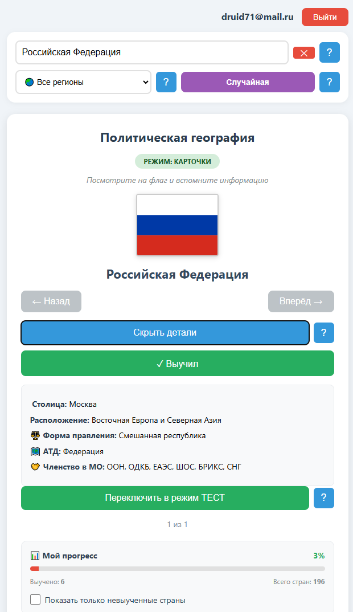
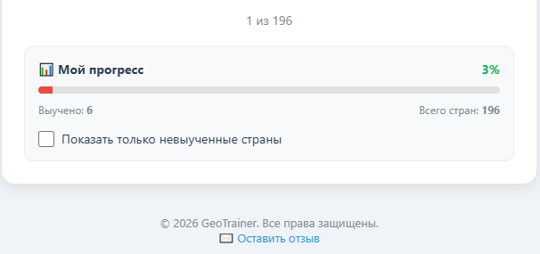
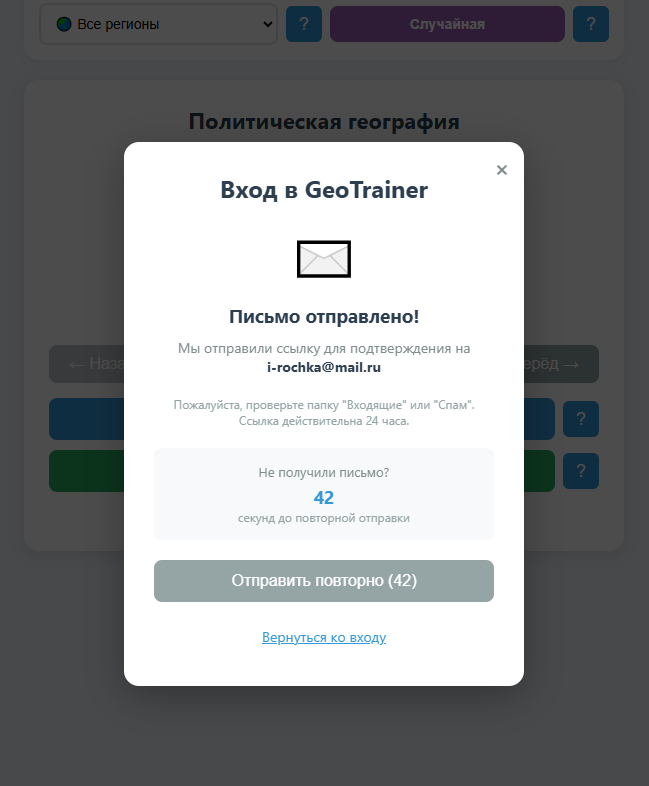

# 🌍 GeoTrainer PRO — Тренажёр по политической географии

Интерактивный веб-тренажёр для изучения флагов, столиц и политического устройства стран мира. Разработан с использованием Supabase Auth и системы отслеживания прогресса.

## ✨ Возможности

-   **Два режима обучения:** Карточки (визуальное запоминание) и Тест (проверка знаний по подсказкам).
-   **Умная система прогресса:** Отмечайте выученные страны, следите за статистикой и цветным прогресс-баром.
-   **Гибкая фильтрация:** Поиск по названию, фильтр по регионам, возможность скрыть уже изученные страны.
-   **Безопасная авторизация:** Регистрация через email с верификацией и защитой от спама.
-   **Адаптивный интерфейс:** Корректно работает на ПК, планшетах и смартфонах.
-   **Защита контента:** Обфусцированный код и защита от копирования.

## 🚀 Быстрый старт

1.  Перейдите на [GitHub Pages проекта](https://a9000235187-cmd.github.io/geotrainer/)
2.  Для доступа ко всем 196 странам нажмите **"Войти"** и зарегистрируйтесь.
3.  Выберите режим "Карточки" или "Тест".
4.  Изучайте страны, отмечайте выученные и следите за своим прогрессом!

## 📸 Скриншоты интерфейса

    
    

 

    

## 🛠 Технологии

-   **Frontend:** HTML5, CSS3, Vanilla JavaScript
-   **Backend & Auth:** Supabase (PostgreSQL, Row Level Security)
-   **Хостинг:** GitHub Pages
-   **Обфускация:** javascript-obfuscator

##  Структура данных

Прогресс пользователя хранится в таблице `profiles` в формате JSON:
`{ "learned": ["ru", "cn"], "lastStudied": "2026-10-13T12:00:00Z" }`

## 🤝 Обратная связь

Нашли баг или есть предложение? 
-   Используйте форму обратной связи на сайте
-   Или напишите нам: support@geotrainer.ru

## 📅 История разработки

-   **02.10.2026:** Старт проекта, формирование концепции
-   **11.10.2026:** Начало активной фазы разработки
-   **13.10.2026:** Внедрение Supabase Auth, системы прогресса и статистики

---
© 2026 GeoTrainer PRO v1.0